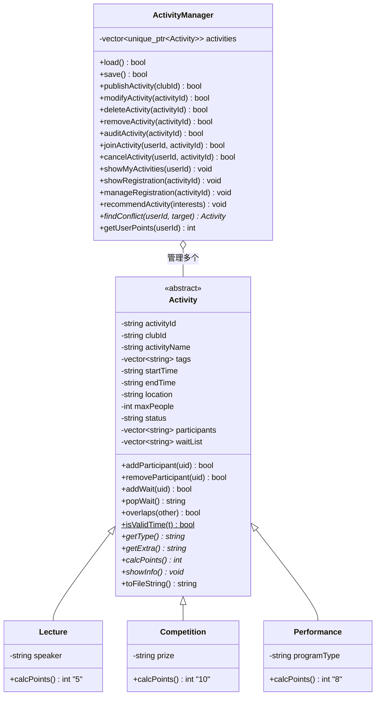
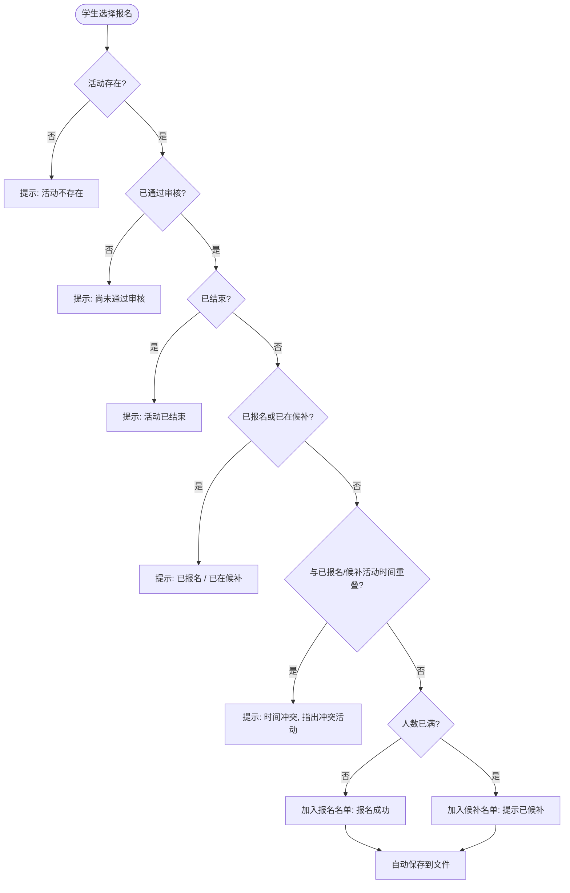
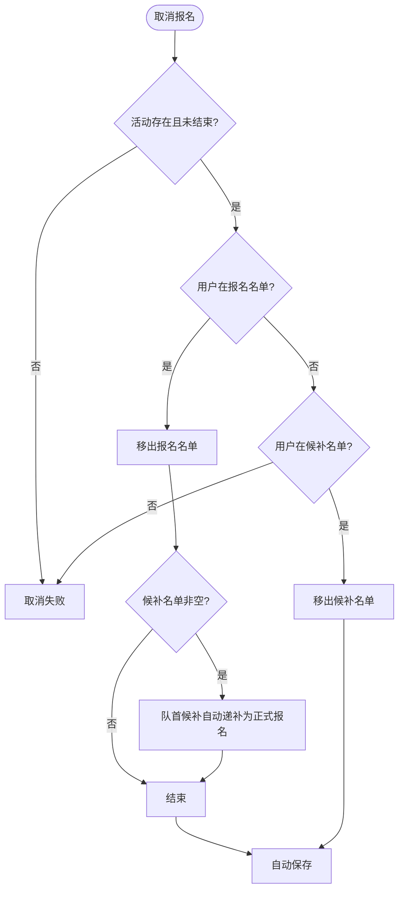

# 活动管理子系统设计（成员 C）

## 1. 类图

## 2. 报名流程（joinActivity）

## 3. 取消与候补递补流程（cancelActivity）

## 4. 关键算法

| 算法 | 位置 | 思路 | 复杂度 |
|---|---|---|---|
| 时间冲突检测 | `Activity::overlaps`、`ActivityManager::findConflict` | 两区间重叠当且仅当 `a.start < b.end && b.start < a.end`；时间为固定格式字符串，可直接比较；遍历该用户已报名和候补的活动逐一判断 | O(n) |
| 兴趣匹配度 | `ActivityManager::matchScore` | Jaccard：`交集 / 并集`，用 `set` 求交集 | O(m log m) |
| 推荐排序 | `ActivityManager::recommend` | 过滤未审核、已结束、已报名的活动，按匹配度降序，相同则开始时间早的在前，`stable_sort` | O(n log n) |
| 候补递补 | `promoteWaiting` | 名额空出后按候补队首依次转正，直到名额满或队列空 | O(k) |
| 时间合法性校验 | `Activity::isValidTime` | 固定格式逐位检查，再按月份天数和闰年判断日期是否存在 | O(1) |
| 积分统计 | `ActivityManager::getUserPoints` | 累加用户已报名、已审核、已结束活动的 `calcPoints()`（多态） | O(n) |

## 5. 数据文件

`data/activities.txt`：`id|clubId|type|name|tags|start|end|location|max|status|extra`

`data/registrations.txt`：`userId|activityId|registered` 或 `userId|activityId|waitlist`（同一活动内的先后顺序即候补顺序）
